# verify-local

A Rust toolbox for bounded local correctness verification, with compact agent-facing results and a language-neutral JSONL adapter protocol. The worked example is an asynchronous Rust proxy that provides append-only virtual objects over S3.

The implementation includes explicit properties, controlled scheduling and faults, exact action replay, failure reduction, contract-preserving regression, and evidence files. It follows the useful Antithesis-style workflow of specifying properties and searching difficult execution histories. Its deterministic boundary is the application adapter; native scheduling, weak memory, and real provider behavior require their own verification backends.

## Quick start

Requirements: Rust 1.100.0, Python 3.10+, and Node.js 22+. Linux is the exercised target. The toolchain file pins Rust, rustfmt, and Clippy. The runtime binaries have no Python or JavaScript dependency; those interpreters are used by the demonstration adapters and orchestration scripts.

```bash
cargo build --release --workspace --locked
python3 scripts/demo.py --skip-build
python3 scripts/http-demo.py
```

The verifier demonstration checks all of these outcomes automatically:

1. Find a lost-update counterexample in the deliberately broken simulator.
2. Replay the complete original execution exactly.
3. Reduce the trace while preserving its property and failure signature.
4. Run the reduced scenario against the correct implementation with the same pinned oracle.
5. Complete a fresh 100-run, 10,000-action append campaign with every required witness present.
6. Run Python and JavaScript adapters through the same Rust controller.

Evidence stays in a new ignored `.verify/demo-*` directory. The script prints compact results and the final evidence path. Recorded results, environment, and benchmark scope are in [validation.json](docs/validation.json).

## Workspace

| Component | Responsibility |
| --- | --- |
| `verify-local` | Compact CLI, bounded subprocess transport, exploration, exact replay, reduction, regression, paged reports |
| `verify-protocol` | Typed JSONL v1 messages, strict JSON parsing, canonicalization and protocol validation |
| `append-core` | Pure production append planning, idempotency intent, offsets, receipts and manifest validation |
| `append-proxy` | Axum HTTP service, real S3 adapter, immutable segments, conditional manifest writes and snapshot reads |
| `append-sim` | Controlled transition adapter using the production planner plus an independent history oracle |
| `examples/python`, `examples/javascript` | Equivalent standard-library adapters proving language-neutral operation |
| `skills/verify-local` | Compact agent instructions and on-demand protocol references |

```mermaid
flowchart TD
    Agent[Agent] --> CLI[Rust controller]
    CLI -->|JSONL actions| Adapter[Language adapter]
    Adapter --> Core[Production logic]
    Adapter --> Oracle[Independent checks]
    CLI --> Evidence[Local evidence]
    Evidence -->|Paged summary| Agent
    Proxy[HTTP proxy] --> Core
    Proxy --> S3[Conditional S3 store]
```



## Context-efficient tooling

```bash
target/release/verify-local doctor verify.append.json
target/release/verify-local run verify.append.json \
  --out .verify/my-run --runs 100 --steps 100 --seconds 30
target/release/verify-local report .verify/my-run/campaign.json
```

Default output is one compact JSON object containing the outcome, counts, failure identity, missing evidence, and artifact paths. Full identities and event histories stay in files. `report TRACE --events --from 0 --limit 8` reads a bounded event page. Summary output is capped at 12 KiB.

| Operation | Purpose |
| --- | --- |
| `doctor` | Validate manifest and execution identity without launching code |
| `run` | Explore legal actions within explicit run, step, time and I/O limits |
| `replay` | Require the original identity and compare every response |
| `shrink` | Retain a shorter valid, reproducible failure of the same signature |
| `regression` | Exercise a preserved failure scenario against changed code with the same pinned contract |
| `report` | Read a concise campaign or trace summary, with optional event pagination |

A clean campaign reports `NO_FAILURE_WITHIN_BOUNDS`. Failure, missing evidence, and harness problems are distinct outcomes and exit codes. Every completed execution is replayed; full clean traces are sampled for retention. There is no correctness probability attached to a finite campaign.

See [verification.md](docs/verification.md) for the protocol, manifests, identity rules, resource boundaries, and adapter authoring. The Python and JavaScript examples each model a durable idempotent counter with a checkpoint, lost reply, process restart, and retry. Their matching JSON responses demonstrate cross-language protocol compatibility.

## Append proxy

Start an ephemeral local instance:

```bash
target/release/append-proxy --memory --listen 127.0.0.1:8787
```

Append a record, append another, and read the resulting stream:

```bash
curl --fail-with-body -X POST http://127.0.0.1:8787/v1/objects/logs/example \
  -H 'Idempotency-Key: record-1' -H 'Append-Offset: 0' --data-binary 'hello '
curl --fail-with-body -X POST http://127.0.0.1:8787/v1/objects/logs/example \
  -H 'Idempotency-Key: record-2' -H 'Append-Offset: 6' --data-binary 'world'
curl --fail-with-body http://127.0.0.1:8787/v1/objects/logs/example
curl --fail-with-body -H 'Range: bytes=4-8' http://127.0.0.1:8787/v1/objects/logs/example
```

Repeat an append with the same ID, body, and offset intent to receive its original receipt. Changed content or changed offset intent under that ID is a conflict. Omitting `Append-Offset` requests a blind append, ordered by the winning conditional manifest writes.

For a real S3 bucket, configure the standard AWS credential chain, `APPEND_S3_BUCKET`, and `AWS_REGION`, then run without `--memory`. `APPEND_S3_ENDPOINT` supports a custom endpoint; `--allow-http` explicitly enables a local HTTP test endpoint. Use an exclusively owned prefix. `APPEND_BEARER_TOKEN` enables HTTP bearer authentication and is required when binding outside loopback. Place TLS and client connection/idle limits at the edge when exposing the service.

### Commit protocol

Each append writes a new immutable data segment, then publishes an updated manifest with an atomic conditional write. The successful manifest CAS is the commit point. The manifest stores order, offsets, hashes, and the original idempotency receipt. A conflict or ambiguous response triggers a fresh manifest read and receipt lookup. A retry resolves an existing receipt before validating a now-stale expected offset.

Readers pin one manifest and stream its immutable segments in order. Bounded prefetch and backpressure control buffering. Reads validate each fetched segment's length and SHA-256; a byte-range request fetches and validates the full overlapping segments. The underlying bucket contains segments and manifests; clients access logical concatenated objects through this proxy API.

The implementation uses Tokio, Axum, shared `Bytes`, a pooled `object_store` S3 client, bounded payloads, immediate load shedding, and bounded body ingestion. Appending transfers the new payload and the updated metadata. Metadata grows with the number of records, and a single hot object serializes at its manifest CAS.

### Limits and qualification

Defaults are 8 MiB per append, 4,096 manifest records, 4 MiB serialized manifest, 16 admitted requests, and 4 prefetched segments per reader. Full capacity returns an explicit error and retains idempotency receipts. The current release retains orphan segments and does not implement deletion, garbage collection, compaction, paged manifests, multipart upload, or full S3 API compatibility.

The proxy tests include actual AmazonS3-client requests against a local wire-contract emulator, opaque ETags, two service instances, stale CAS conflicts, committed writes with lost responses, bounded unresolved outcomes, concurrent appends, snapshot/range reads, validation, and stalled uploads. Dedicated real AWS qualification remains a separate deployment gate.

AWS offers native append for S3 Express One Zone directory buckets. This proxy's manifest/segment format is useful when targeting general-purpose buckets or compatible stores with the required conditional-write semantics. See [S3 semantics](docs/s3-semantics.md) and the [AWS native append documentation](https://docs.aws.amazon.com/AmazonS3/latest/userguide/directory-buckets-objects-append.html).

## Performance

Run the production service's local storage-path benchmark:

```bash
target/release/append-bench --records 2000 --objects 32 --concurrency 8 --bytes 65536
```

The benchmark reports throughput and p50/p95/p99 latency and verifies that all records committed. It measures hashing, append planning, manifest serialization and conditional updates against in-process memory storage. It reuses immutable payload buffers. HTTP transport, per-request upload allocation, network latency, AWS durability, and provider cost are outside that measurement. Use the recorded scope when interpreting [validation.json](docs/validation.json).

Observed on a shared Intel Xeon Platinum 8573C host with nine available logical CPUs:

| Workload | Appends/s | Logical MiB/s | p50 / p95 / p99 |
| --- | ---: | ---: | --- |
| 2,000 records over 32 objects, 8 workers, 64 KiB | 11,244 | 703 | 233 / 2,737 / 10,107 microseconds |
| 1,000 records on one object, 8 workers, 64 KiB | 725 | 45.3 | 1,322 / 2,577 / 54,385 microseconds |

These are local service-path measurements under the scope above. The hot-object result makes the manifest contention cost visible.

## Development

```bash
cargo fmt --all -- --check
cargo clippy --workspace --all-targets --locked -- -D warnings
cargo test --workspace --locked
```

The CI workflow runs these gates, builds the binaries, and executes both the cross-language verification demonstration and the actual HTTP demonstration. Use the installed `verify-local` skill or the exported skill directory to guide application integration. Keep property implementations and production code changes separately reviewable.

Apache-2.0 licensed. This project is an independent local implementation inspired by property-driven deterministic testing. Antithesis is a separate commercial system.
